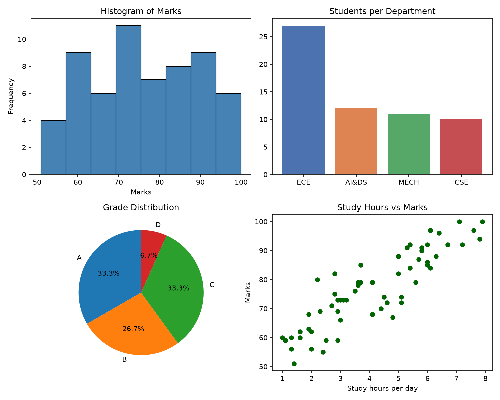

# DATA SCIENCE USING PYTHON

## EXPERIMENT 3 - Exploratory Data Analysis and Graphical Presentation

### AIM:

To classify the attributes of a student performance dataset and explore it using descriptive statistics and graphs.

### QUESTION:

An engineering college wants to understand the factors that affect student marks. A dataset of 60 students contains gender, department, grade, attendance, daily study hours and marks. Perform exploratory data analysis (EDA) to classify each attribute, summarise the data numerically and present it graphically.

The program must:

1. Classify each attribute as nominal, ordinal, discrete or continuous.
2. Compute mean, median, mode, standard deviation, quartiles and skewness.
3. Build frequency tables, a cross-tabulation and a correlation matrix.
4. Draw a histogram, bar chart, pie chart and scatter plot.
5. Interpret the relationship between study hours and marks.

### ALGORITHM:

1. Import NumPy, pandas and Matplotlib libraries.
2. Generate a dataset containing 60 students using a fixed random seed.
3. Create attributes such as roll number, gender, department, grade, attendance and study hours.
4. Calculate student marks using study hours, attendance and random variations.
5. Display the first five records of the dataset.
6. Classify each attribute into nominal, ordinal, discrete or continuous types.
7. Calculate mean, median, mode, standard deviation, quartiles and skewness.
8. Generate department frequency tables and department-versus-grade cross-tabulation.
9. Calculate the correlation matrix for attendance, study hours and marks.
10. Draw a histogram, bar chart, pie chart and scatter plot.
11. Save all four graphs as an image.
12. Interpret the correlation between study hours and marks.

### CODE:

```python
import numpy as np
import pandas as pd
import matplotlib.pyplot as plt

np.random.seed(7)
n = 60

students = pd.DataFrame(
    {
        "roll_no": range(1, n + 1),
        "gender": np.random.choice(["Male", "Female"], n),
        "department": np.random.choice(
            ["CSE", "ECE", "MECH", "AI&DS"], n, p=[0.3, 0.25, 0.2, 0.25]
        ),
        "grade": np.random.choice(
            ["A", "B", "C", "D"], n, p=[0.25, 0.4, 0.25, 0.1]
        ),
        "attendance": np.random.randint(60, 100, n),
        "study_hours": np.round(np.random.uniform(1, 8, n), 1),
    }
)

students["marks"] = np.clip(
    (
        35
        + 6 * students["study_hours"]
        + 0.2 * students["attendance"]
        + np.random.normal(0, 6, n)
    ).round(),
    0,
    100,
).astype(int)

print("Student Performance: Exploratory Data Analysis")
print("=" * 50)

print("\nFirst 5 records:")
print(students.head().to_string(index=False))

# ---------- Classification of data ----------

data_types = {
    "roll_no": "Nominal (identifier)",
    "gender": "Qualitative - Nominal",
    "department": "Qualitative - Nominal",
    "grade": "Qualitative - Ordinal",
    "attendance": "Quantitative - Discrete",
    "study_hours": "Quantitative - Continuous",
    "marks": "Quantitative - Discrete",
}

print("\nClassification of attributes:")
for col, t in data_types.items():
    print(f" {col:<12} : {t}")

# ---------- Descriptive statistics ----------

num = students[["attendance", "study_hours", "marks"]]

print("\nSummary statistics:")
print(num.describe().round(2).to_string())

print("\nMedian :", num.median().to_dict())
print("Mode of grade :", students["grade"].mode()[0])
print("Skewness of marks :", round(students["marks"].skew(), 3))

print("\nFrequency table - department:")
print(students["department"].value_counts().to_string())

print("\nCross table - department vs grade:")
print(pd.crosstab(students["department"], students["grade"]).to_string())

print("\nCorrelation matrix:")
print(num.corr().round(3).to_string())

# ---------- Graphical presentation ----------

fig, ax = plt.subplots(2, 2, figsize=(10, 8))

ax[0, 0].hist(students["marks"], bins=8, color="steelblue", edgecolor="black")
ax[0, 0].set_title("Histogram of Marks")
ax[0, 0].set_xlabel("Marks")
ax[0, 0].set_ylabel("Frequency")

dept = students["department"].value_counts()
ax[0, 1].bar(
    dept.index, dept.values, color=["#4c72b0", "#dd8452", "#55a868", "#c44e52"]
)
ax[0, 1].set_title("Students per Department")

grade = students["grade"].value_counts().sort_index()
ax[1, 0].pie(grade.values, labels=grade.index, autopct="%1.1f%%", startangle=90)
ax[1, 0].set_title("Grade Distribution")

ax[1, 1].scatter(students["study_hours"], students["marks"], c="darkgreen")
ax[1, 1].set_title("Study Hours vs Marks")
ax[1, 1].set_xlabel("Study hours per day")
ax[1, 1].set_ylabel("Marks")

plt.tight_layout()
plt.savefig("exp03_eda.png", dpi=150)
plt.show()
print("\nPlot saved as exp03_eda.png")
```

### OUTPUT:

```text
Student Performance: Exploratory Data Analysis
==================================================

First 5 records:
 roll_no gender department grade attendance study_hours marks
       1 Female CSE       C     60          4.1         79
       2 Male   ECE       D     69          7.1        100
       3 Female ECE       A     94          3.7         85
       4 Male   ECE       C     65          1.0         60
       5 Female ECE       B     81          2.0         56

Classification of attributes:
 roll_no      : Nominal (identifier)
 gender       : Qualitative - Nominal
 department   : Qualitative - Nominal
 grade        : Qualitative - Ordinal
 attendance   : Quantitative - Discrete
 study_hours  : Quantitative - Continuous
 marks        : Quantitative - Discrete

Summary statistics:
       attendance study_hours marks
count       60.00       60.00 60.00
mean        79.53        4.11 76.57
std         11.29        1.91 12.98
min         60.00        1.00 51.00
25%         70.50        2.65 67.75
50%         78.50        3.90 75.50
75%         90.25        5.72 87.25
max         99.00        7.90 100.00

Median : {'attendance': 78.5, 'study_hours': 3.9, 'marks': 75.5}
Mode of grade : A
Skewness of marks : -0.014

Frequency table - department:
department
ECE      27
AI&DS    12
MECH     11
CSE      10

Cross table - department vs grade:
grade       A B C D
department
AI&DS       3 4 4 1
CSE         4 1 4 1
ECE         9 7 9 2
MECH        4 4 3 0

Correlation matrix:
             attendance study_hours marks
attendance        1.000       0.072 0.214
study_hours       0.072       1.000 0.880
marks             0.214       0.880 1.000

Plot saved as exp03_eda.png
```

### GRAPHICAL OUTPUT:



1. Histogram of Marks
2. Students per Department
3. Grade Distribution
4. Study Hours vs Marks

### RESULT:

Thus, exploratory data analysis was successfully performed on a dataset of 60 students. The attributes were classified, descriptive statistics were calculated, frequency tables and a correlation matrix were generated, and four graphical representations were created.

The correlation coefficient of 0.880 indicates a strong positive relationship between daily study hours and student marks.
