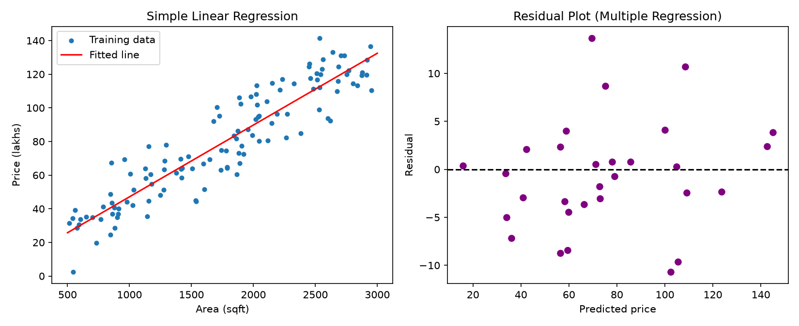

# DATA SCIENCE USING PYTHON
**Date:** 19-11-26
## EXPERIMENT 5 - Linear Regression for House Price Prediction

### AIM:

To build and evaluate simple and multiple linear regression models for predicting house prices.

### QUESTION:

A real-estate firm wants to estimate house prices from the built-up area, number of bedrooms, age of the building and distance from the city centre. Map this business problem to a regression task, fit simple and multiple linear regression models, and evaluate how well they predict prices on unseen data.

The program must:

1. Explore the correlation of each feature with the price.
2. Fit a simple linear regression (price vs area) and report the slope and intercept.
3. Fit a multiple linear regression model and interpret each coefficient.
4. Evaluate the model using MAE, MSE, RMSE and R-squared on a test set.
5. Predict the price of a new house and plot the fitted line and residuals.

### ALGORITHM:

1. Import NumPy, pandas, Matplotlib and Scikit-learn libraries.
2. Generate a dataset containing 150 houses with area, bedrooms, age and distance features.
3. Calculate house prices using the given linear equation and random noise.
4. Display the first five records and calculate feature correlations with house prices.
5. Separate the input features and target price.
6. Split the dataset into training and testing sets.
7. Train a simple linear regression model using house area.
8. Display the intercept, slope and test R-squared value.
9. Train a multiple linear regression model using all four features.
10. Display the model coefficients and interpret their effects on house prices.
11. Evaluate the model using MAE, MSE, RMSE and R-squared.
12. Predict the price of a new house with 1800 sqft area, 3 bedrooms, 5 years of age and 8 km distance.
13. Plot the regression fitted line and residual plot.
14. Save the graphical output as an image.

### CODE:

```python
import numpy as np
import pandas as pd
import matplotlib.pyplot as plt
from sklearn.linear_model import LinearRegression
from sklearn.model_selection import train_test_split
from sklearn.metrics import mean_absolute_error, mean_squared_error, r2_score

np.random.seed(10)
n = 150

area = np.random.randint(500, 3000, n)
bedrooms = np.random.randint(1, 5, n)
age = np.random.randint(0, 30, n)
distance = np.round(np.random.uniform(1, 25, n), 1)

price = (
    15
    + 0.045 * area
    + 4 * bedrooms
    - 0.6 * age
    - 1.2 * distance
    + np.random.normal(0, 6, n)
)  # price in lakhs

houses = pd.DataFrame(
    {
        "area_sqft": area,
        "bedrooms": bedrooms,
        "age_years": age,
        "distance_km": distance,
        "price_lakhs": price.round(2),
    }
)

print("House Price Prediction using Linear Regression")
print("=" * 50)
print(houses.head().to_string(index=False))

print("\nCorrelation with price:")
print(houses.corr()["price_lakhs"].drop("price_lakhs").round(3).to_string())

X = houses.drop(columns="price_lakhs")
y = houses["price_lakhs"]

X_train, X_test, y_train, y_test = train_test_split(
    X, y, test_size=0.2, random_state=1
)

# ---------- Simple linear regression (area only) ----------

simple = LinearRegression().fit(X_train[["area_sqft"]], y_train)

print("\nSimple Linear Regression: price = b0 + b1 * area")
print(f" b0 (intercept) = {simple.intercept_:.4f}")
print(f" b1 (slope)      = {simple.coef_[0]:.4f}")
print(
    f" R^2 on test     = {r2_score(y_test, simple.predict(X_test[['area_sqft']])):.4f}"
)

# ---------- Multiple linear regression ----------

model = LinearRegression().fit(X_train, y_train)

print("\nMultiple Linear Regression coefficients:")
print(f" {'Intercept':<12} {model.intercept_:>9.4f}")

for name, c in zip(X.columns, model.coef_):
    print(f" {name:<12} {c:>9.4f}")

pred = model.predict(X_test)
mse = mean_squared_error(y_test, pred)

print("\nModel evaluation on test set:")
print(f" MAE = {mean_absolute_error(y_test, pred):.4f}")
print(f" MSE = {mse:.4f}")
print(f" RMSE = {np.sqrt(mse):.4f}")
print(f" R^2 = {r2_score(y_test, pred):.4f}")

new_house = pd.DataFrame([[1800, 3, 5, 8.0]], columns=X.columns)

print(
    "\nPredicted price for 1800 sqft, 3 BHK, 5 yrs old, 8 km away:",
    f"{model.predict(new_house)[0]:.2f} lakhs",
)

# ---------- Graphical presentation ----------

fig, ax = plt.subplots(1, 2, figsize=(11, 4.5))

xs = np.linspace(500, 3000, 100).reshape(-1, 1)

ax[0].scatter(X_train["area_sqft"], y_train, s=15, label="Training data")

ax[0].plot(
    xs,
    simple.predict(pd.DataFrame(xs, columns=["area_sqft"])),
    color="red",
    label="Fitted line",
)

ax[0].set_xlabel("Area (sqft)")
ax[0].set_ylabel("Price (lakhs)")
ax[0].set_title("Simple Linear Regression")
ax[0].legend()

ax[1].scatter(pred, y_test - pred, color="purple")
ax[1].axhline(0, color="black", linestyle="--")
ax[1].set_xlabel("Predicted price")
ax[1].set_ylabel("Residual")
ax[1].set_title("Residual Plot (Multiple Regression)")

plt.tight_layout()
plt.savefig("exp05_regression.png", dpi=150)
plt.show()
```

### OUTPUT:

```text
House Price Prediction using Linear Regression
==================================================
 area_sqft  bedrooms  age_years  distance_km  price_lakhs
      1789         1         22         22.5        64.07
      1027         1         29          2.4        41.98
      1844         3         10         10.7        83.57
      1680         3          7          4.1        92.16
      2509         3         28          3.1       120.57

Correlation with price:
area_sqft      0.923
bedrooms       0.060
age_years     -0.130
distance_km   -0.223

Simple Linear Regression: price = b0 + b1 * area
 b0 (intercept) = 4.4216
 b1 (slope)      = 0.0427
 R^2 on test     = 0.8528

Multiple Linear Regression coefficients:
 Intercept      19.5214
 area_sqft       0.0444
 bedrooms        3.0285
 age_years      -0.6860
 distance_km    -1.1889

Model evaluation on test set:
 MAE = 4.3166
 MSE = 31.6882
 RMSE = 5.6292
 R^2 = 0.9709

Predicted price for 1800 sqft, 3 BHK, 5 yrs old, 8 km away: 95.63 lakhs
```

### GRAPHICAL OUTPUT:



1. Simple Linear Regression – House Area vs Price.
2. Residual Plot – Multiple Regression.

### RESULT:

Thus, simple and multiple linear regression models were successfully developed for house price prediction. The multiple linear regression model achieved an R-squared value of 0.9709 with an RMSE of 5.6292. The predicted price for the new house was 95.63 lakhs.
