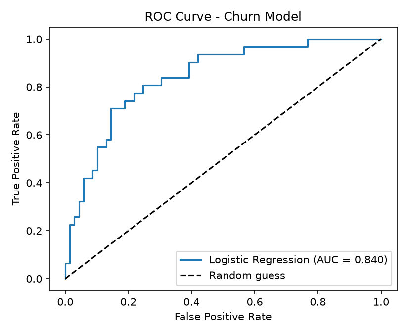

# DATA SCIENCE USING PYTHON
**Date:** 20-11-26
## EXPERIMENT 6 - Logistic Regression for Customer Churn Prediction

### AIM:

To predict customer churn using logistic regression and validate the model with standard classification metrics.

### QUESTION:

A telecom operator wants to identify customers who are likely to leave so that the retention team can contact them. Using tenure, monthly bill, number of complaints and contract type, build a logistic regression classifier and validate it.

The program must:

1. Split the data into stratified training and test sets.
2. Train a logistic regression model on standardised features.
3. Report the coefficients and odds ratios and interpret them.
4. Validate the model using accuracy, precision, recall, F1-score, confusion matrix and ROC-AUC.
5. Perform 5-fold cross-validation and predict the churn probability of a new customer.

### ALGORITHM:

1. Import NumPy, pandas, Matplotlib and Scikit-learn libraries.
2. Generate a telecom customer dataset containing 400 records.
3. Create features such as tenure, monthly bill, complaints and contract type.
4. Calculate churn probability using the logistic function.
5. Display the first five records and churn distribution.
6. Separate input features and the target variable.
7. Split the dataset into stratified training and testing sets.
8. Create a pipeline using StandardScaler and LogisticRegression.
9. Train the logistic regression model.
10. Calculate model coefficients and odds ratios.
11. Evaluate the model using accuracy, precision, recall, F1-score and ROC-AUC.
12. Display the confusion matrix.
13. Perform 5-fold cross-validation and calculate mean accuracy and standard deviation.
14. Predict the churn probability of a new customer.
15. Plot and save the ROC curve.

### CODE:

```python
import numpy as np
import pandas as pd
import matplotlib.pyplot as plt
from sklearn.linear_model import LogisticRegression
from sklearn.model_selection import train_test_split, cross_val_score
from sklearn.preprocessing import StandardScaler
from sklearn.pipeline import make_pipeline
from sklearn.metrics import (
    accuracy_score,
    precision_score,
    recall_score,
    f1_score,
    confusion_matrix,
    roc_auc_score,
    roc_curve,
)

np.random.seed(3)
n = 400

tenure = np.random.randint(1, 72, n)
monthly = np.round(np.random.uniform(200, 1500, n), 0)
complaints = np.random.poisson(1.2, n)
contract = np.random.choice([0, 1], n, p=[0.55, 0.45])

# 1 = yearly contract

logit = -1.0 - 0.06 * tenure + 0.002 * monthly + 0.7 * complaints - 1.3 * contract

churn = (np.random.rand(n) < 1 / (1 + np.exp(-logit))).astype(int)

data = pd.DataFrame(
    {
        "tenure_months": tenure,
        "monthly_bill": monthly,
        "complaints": complaints,
        "yearly_contract": contract,
        "churn": churn,
    }
)

print("Telecom Customer Churn Prediction using Logistic Regression")
print("=" * 60)
print(data.head().to_string(index=False))
print("\nChurn distribution:", data["churn"].value_counts().to_dict())

X = data.drop(columns="churn")
y = data["churn"]

X_train, X_test, y_train, y_test = train_test_split(
    X, y, test_size=0.25, stratify=y, random_state=0
)

model = make_pipeline(StandardScaler(), LogisticRegression())
model.fit(X_train, y_train)

lr = model.named_steps["logisticregression"]

print("\nCoefficients (standardised features):")
for name, c in zip(X.columns, lr.coef_[0]):
    print(f" {name:<16} {c:>8.4f}    odds ratio = {np.exp(c):.3f}")

print(f" {'Intercept':<16} {lr.intercept_[0]:>8.4f}")

pred = model.predict(X_test)
prob = model.predict_proba(X_test)[:, 1]

print("\nValidation on test set:")
print(f" Accuracy = {accuracy_score(y_test, pred):.4f}")
print(f" Precision = {precision_score(y_test, pred):.4f}")
print(f" Recall     = {recall_score(y_test, pred):.4f}")
print(f" F1-score = {f1_score(y_test, pred):.4f}")
print(f" ROC-AUC    = {roc_auc_score(y_test, prob):.4f}")

print("\nConfusion Matrix [rows = actual, cols = predicted]:")
print(confusion_matrix(y_test, pred))

cv = cross_val_score(model, X, y, cv=5, scoring="accuracy")
print("\n5-fold cross-validation accuracy:", np.round(cv, 4))
print(f"Mean = {cv.mean():.4f}, Std = {cv.std():.4f}")

customer = pd.DataFrame([[4, 1250, 3, 0]], columns=X.columns)
p = model.predict_proba(customer)[0, 1]

print(
    "\nNew customer (4 months, Rs.1250, 3 complaints, monthly plan):",
    f"churn probability = {p:.3f}",
)

fpr, tpr, _ = roc_curve(y_test, prob)

plt.figure(figsize=(5.5, 4.5))
plt.plot(
    fpr,
    tpr,
    label=f"Logistic Regression (AUC = {roc_auc_score(y_test, prob):.3f})",
)
plt.plot([0, 1], [0, 1], "k--", label="Random guess")
plt.xlabel("False Positive Rate")
plt.ylabel("True Positive Rate")
plt.title("ROC Curve - Churn Model")
plt.legend()
plt.tight_layout()
plt.savefig("exp06_roc.png", dpi=150)
plt.show()
```

### OUTPUT:

```text
Telecom Customer Churn Prediction using Logistic Regression
============================================================

tenure_months  monthly_bill  complaints  yearly_contract  churn
25             451.0         0           1                0
4              1144.0        2           0                1
57             907.0         0           1                0
1              895.0         3           1                1
22             804.0         2           0                1

Churn distribution: {0: 275, 1: 125}

Coefficients (standardised features):
tenure_months    -0.9840    odds ratio = 0.374
monthly_bill      0.5949    odds ratio = 1.813
complaints        0.8709    odds ratio = 2.389
yearly_contract  -0.3919    odds ratio = 0.676
Intercept        -1.0822

Validation on test set:
Accuracy  = 0.7600
Precision = 0.7333
Recall    = 0.3548
F1-score  = 0.4783
ROC-AUC   = 0.8401

Confusion Matrix [rows = actual, cols = predicted]:
[[65  4]
 [20 11]]

5-fold cross-validation accuracy: [0.8125 0.825 0.775 0.75 0.6875]
Mean = 0.7700, Std = 0.0491

New customer (4 months, Rs.1250, 3 complaints, monthly plan):
churn probability = 0.945
```

### GRAPHICAL OUTPUT:



The ROC curve represents the relationship between the true positive rate and false positive rate. The AUC value of 0.840 indicates good classification performance.

### RESULT:

Thus, a logistic regression model was successfully developed to predict telecom customer churn. The model was evaluated using standard classification metrics and 5-fold cross-validation. The ROC-AUC value was 0.8401, and the new customer's predicted churn probability was 0.945.

The model helps identify customers with a high likelihood of leaving and supports customer retention planning.
