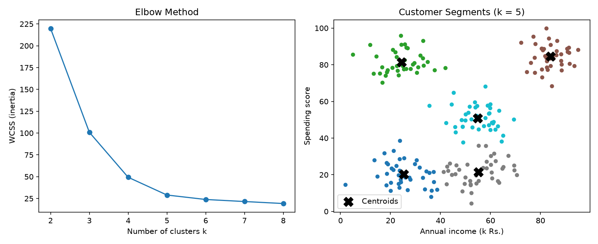

# EXPERIMENT 8 – K-Means Clustering for Customer Segmentation

## AIM:

To segment mall customers using K-means clustering and evaluate the clusters.

## QUESTION:

A shopping mall wants to group its customers by annual income and spending score in order to design targeted marketing campaigns. Since no labels are available, apply the unsupervised K-means algorithm, choose the number of clusters and describe each segment.

The program must:

1. Standardise the income and spending score features.
2. Run K-means for k = 2 to 8 and record WCSS (inertia) and silhouette score.
3. Select the best k using the elbow method and silhouette analysis.
4. Profile each cluster by mean income, mean spending score and size.
5. Plot the elbow curve and the clusters with their centroids.

## ALGORITHM:

1. Import the required Python libraries.
2. Generate customer data using annual income and spending scores.
3. Standardise the customer features using StandardScaler.
4. Apply K-Means clustering for k values from 2 to 8.
5. Calculate WCSS and silhouette scores for each k.
6. Select the best k based on the highest silhouette score.
7. Train the final K-Means model and assign cluster labels.
8. Calculate the mean income, spending score and size of each cluster.
9. Display the customer segments and plot the elbow curve and clusters with centroids.

## CODE:

```python
import numpy as np
import pandas as pd
import matplotlib.pyplot as plt
from sklearn.cluster import KMeans
from sklearn.preprocessing import StandardScaler
from sklearn.metrics import silhouette_score

np.random.seed(5)
centres = [(25, 80), (55, 20), (85, 85), (55, 50), (25, 20)]
rows = []

for i, (inc, score) in enumerate(centres):
    for _ in range(40):
        rows.append([np.random.normal(inc, 7), np.random.normal(score, 7)])

customers = pd.DataFrame(
    np.round(rows, 1), columns=["annual_income_k", "spending_score"]
)
customers.insert(0, "customer_id", range(1, len(customers) + 1))

print("Mall Customer Segmentation using K-Means Clustering")
print("=" * 52)
print(customers.head().to_string(index=False))
print("Total customers:", len(customers))

X = StandardScaler().fit_transform(
    customers[["annual_income_k", "spending_score"]]
)

print("\n k     WCSS     Silhouette")
wcss, sil = [], []

for k in range(2, 9):
    km = KMeans(n_clusters=k, n_init=10, random_state=0).fit(X)
    wcss.append(km.inertia_)
    sil.append(silhouette_score(X, km.labels_))
    print(f"{k:>2} {km.inertia_:>8.2f}    {sil[-1]:.4f}")

best_k = range(2, 9)[int(np.argmax(sil))]
print("\nBest k by silhouette score:", best_k)

km = KMeans(n_clusters=best_k, n_init=10, random_state=0).fit(X)
customers["cluster"] = km.labels_

profile = (
    customers.groupby("cluster")[["annual_income_k", "spending_score"]]
    .mean()
    .round(1)
)
profile["size"] = customers["cluster"].value_counts().sort_index()


def describe(row):
    inc = (
        "High income"
        if row.annual_income_k > 70
        else "Low income" if row.annual_income_k < 40 else "Mid income"
    )
    sp = (
        "high spender"
        if row.spending_score > 65
        else "low spender" if row.spending_score < 35 else "average spender"
    )
    return f"{inc}, {sp}"


profile["segment"] = profile.apply(describe, axis=1)
print("\nCluster profiles:")
print(profile.to_string())

fig, ax = plt.subplots(1, 2, figsize=(11, 4.5))
ax[0].plot(range(2, 9), wcss, "o-")
ax[0].set_xlabel("Number of clusters k")
ax[0].set_ylabel("WCSS (inertia)")
ax[0].set_title("Elbow Method")

sc = ax[1].scatter(
    customers["annual_income_k"],
    customers["spending_score"],
    c=customers["cluster"],
    cmap="tab10",
    s=20,
)

centres = customers.groupby("cluster")[
    ["annual_income_k", "spending_score"]
].mean()

ax[1].scatter(
    centres.iloc[:, 0],
    centres.iloc[:, 1],
    c="black",
    marker="X",
    s=150,
    label="Centroids",
)

ax[1].set_xlabel("Annual income (k Rs.)")
ax[1].set_ylabel("Spending score")
ax[1].set_title(f"Customer Segments (k = {best_k})")
ax[1].legend()

plt.tight_layout()
plt.savefig("exp08_kmeans.png", dpi=150)
plt.show()
```

## OUTPUT:

```text
Mall Customer Segmentation using K-Means Clustering
====================================================
 customer_id annual_income_k spending_score
           1             28.1            77.7
           2             42.0            78.2
           3             25.8            91.1
           4             18.6            75.9
           5             26.3            77.7
Total customers: 200

 k     WCSS     Silhouette
 2    219.83   0.4884
 3    100.85   0.5802
 4     49.31   0.5993
 5     28.97   0.6140
 6     23.86   0.5865
 7     21.52   0.5107
 8     19.23   0.4817

Best k by silhouette score: 5

Cluster profiles:
         annual_income_k     spending_score   size                       segment
cluster
0                   25.3               20.4     40       Low income, low spender
1                   24.5               81.5     40      Low income, high spender
2                   84.0               84.5     40     High income, high spender
3                   55.2               21.4     40       Mid income, low spender
4                   54.9               50.9     40   Mid income, average spender
```

## GRAPHICAL OUTPUT:



## RESULT:

Thus, K-Means clustering was successfully applied to segment 200 mall customers into five groups based on annual income and spending score. The clusters were evaluated using WCSS and silhouette scores, and their customer profiles were identified.
