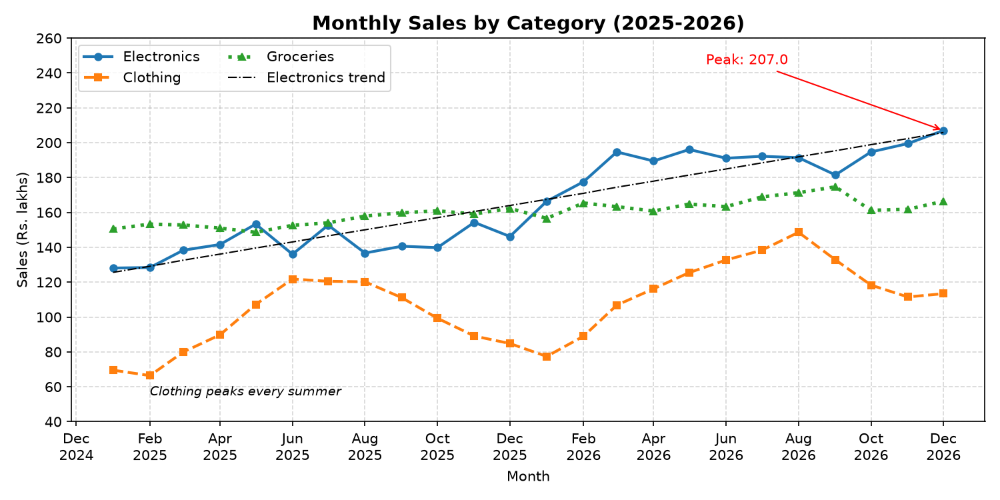
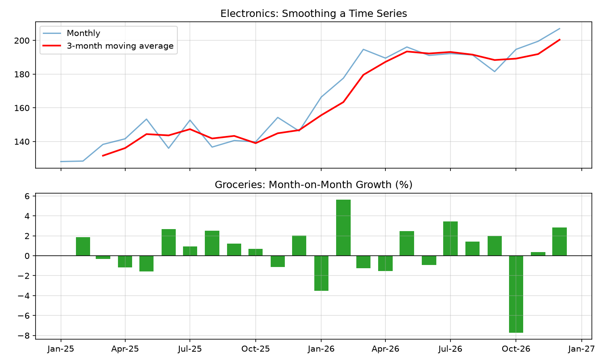

# DATA SCIENCE USING PYTHON

## EXPERIMENT 17 - Line Plots, Formatting and Time-Series Trends

**DATE: 24/11/26**

### AIM:

To visualise monthly sales of a retail chain using formatted line plots and time-series charts.

### QUESTION:

A retail chain has 24 months of sales data for Electronics, Clothing and Groceries. Build publication-quality line charts with Matplotlib showing all three categories, and analyse the trend and seasonality of the series over time.

The program must:

1. Draw multiple lines on one plot with different colours, line styles and markers.
2. Set the title, axis labels, axis limits, ticks, date formatting and grid.
3. Add a legend, an annotation with an arrow and a text label.
4. Fit and draw a linear trend line and a 3-month moving average.
5. Use subplots to show month-on-month growth and save the figures to disk.

### ALGORITHM:

1. Import NumPy, Pandas, Matplotlib and date formatting libraries.
2. Generate 24 months of sales data for Electronics, Clothing and Groceries.
3. Calculate yearly sales totals and identify the peak Electronics sales month.
4. Fit a linear trend line using the least squares method.
5. Calculate the 3-month moving average for Electronics sales.
6. Draw multiple line plots with different colours, markers and line styles.
7. Add titles, axis labels, annotations, legends and grid lines.
8. Create subplots to display time-series smoothing and month-on-month growth.
9. Save the generated figures and display the charts.

### CODE:

```python
import numpy as np
import pandas as pd
import matplotlib.pyplot as plt
import matplotlib.dates as mdates

np.random.seed(1)

months = pd.date_range("2025-01-01", periods=24, freq="MS")
t = np.arange(24)

sales = pd.DataFrame(
    {
        "Electronics": 120
        + 4.0 * t
        + 15 * np.sin(2 * np.pi * t / 12)
        + np.random.normal(0, 5, 24),

        "Clothing": 90
        + 1.5 * t
        + 25 * np.sin(2 * np.pi * (t - 3) / 12)
        + np.random.normal(0, 5, 24),

        "Groceries": 150 + 0.8 * t
        + np.random.normal(0, 4, 24),
    },
    index=months,
).round(1)

print("Monthly Sales Trend Analysis using Line Plots")
print("=" * 46)
print(sales.head(6).to_string())
print("...")

print("\nYearly totals (Rs. lakhs):")
print(sales.groupby(sales.index.year).sum().round(1).to_string())

peak = sales["Electronics"].idxmax()

print(
    f"\nPeak Electronics month: {peak:%b %Y} "
    f"({sales['Electronics'].max()} lakhs)"
)

# Trend line for Electronics using least squares
slope, intercept = np.polyfit(t, sales["Electronics"], 1)

print(
    f"Electronics trend line: "
    f"sales = {intercept:.2f} + {slope:.2f} * month_index"
)

rolling = sales["Electronics"].rolling(3).mean()

# ---------- Figure 1: Formatted multi-line chart ----------

fig, ax = plt.subplots(figsize=(10, 5))

ax.plot(
    sales.index,
    sales["Electronics"],
    color="tab:blue",
    linestyle="-",
    linewidth=2,
    marker="o",
    markersize=5,
    label="Electronics",
)

ax.plot(
    sales.index,
    sales["Clothing"],
    color="tab:orange",
    linestyle="--",
    linewidth=2,
    marker="s",
    markersize=5,
    label="Clothing",
)

ax.plot(
    sales.index,
    sales["Groceries"],
    color="tab:green",
    linestyle=":",
    linewidth=2.5,
    marker="^",
    markersize=5,
    label="Groceries",
)

ax.plot(
    sales.index,
    intercept + slope * t,
    color="black",
    linestyle="-.",
    linewidth=1,
    label="Electronics trend",
)

ax.set_title(
    "Monthly Sales by Category (2025-2026)",
    fontsize=14,
    fontweight="bold"
)

ax.set_xlabel("Month")
ax.set_ylabel("Sales (Rs. lakhs)")
ax.set_ylim(40, 260)
ax.set_yticks(range(40, 261, 20))

ax.xaxis.set_major_locator(mdates.MonthLocator(interval=2))
ax.xaxis.set_major_formatter(mdates.DateFormatter("%b\n%Y"))

ax.grid(True, which="major", linestyle="--", alpha=0.5)

ax.annotate(
    f"Peak: {sales['Electronics'].max()}",
    xy=(peak, sales["Electronics"].max()),
    xytext=(peak - pd.Timedelta(days=200), 245),
    arrowprops=dict(arrowstyle="->", color="red"),
    color="red",
)

ax.text(
    months[1],
    55,
    "Clothing peaks every summer",
    fontsize=9,
    style="italic"
)

ax.legend(loc="upper left", ncol=2, frameon=True)

plt.tight_layout()
plt.savefig("exp17_line.png", dpi=150)

# ---------- Figure 2: Subplots with time-series smoothing ----------

fig, axes = plt.subplots(2, 1, figsize=(10, 6), sharex=True)

axes[0].plot(
    sales.index,
    sales["Electronics"],
    label="Monthly",
    alpha=0.6
)

axes[0].plot(
    sales.index,
    rolling,
    color="red",
    linewidth=2,
    label="3-month moving average"
)

axes[0].set_title("Electronics: Smoothing a Time Series")
axes[0].legend()
axes[0].grid(alpha=0.4)

growth = sales.pct_change().mul(100)

axes[1].bar(
    sales.index,
    growth["Groceries"],
    width=20,
    color="tab:green"
)

axes[1].axhline(0, color="black", linewidth=0.8)
axes[1].set_title("Groceries: Month-on-Month Growth (%)")
axes[1].grid(alpha=0.4)
axes[1].xaxis.set_major_formatter(mdates.DateFormatter("%b-%y"))

plt.tight_layout()
plt.savefig("exp17_timeseries.png", dpi=150)

plt.show()

print("\nSaved figures: exp17_line.png, exp17_timeseries.png")
```

### OUTPUT:

```text
Monthly Sales Trend Analysis using Line Plots
==============================================

            Electronics  Clothing  Groceries
2025-01-01        128.1      69.5      150.5
2025-02-01        128.4      66.4      153.3
2025-03-01        138.3      79.9      152.8
2025-04-01        141.6      89.8      151.0
2025-05-01        153.3     107.2      148.6
2025-06-01        136.0     121.8      152.6
...

Yearly totals (Rs. lakhs):
      Electronics  Clothing  Groceries
2025       1696.0    1159.6     1862.8
2026       2281.7    1410.5     1978.5

Peak Electronics month: Dec 2026 (207.0 lakhs)

Electronics trend line: sales = 125.62 + 3.49 * month_index

Saved figures: exp17_line.png, exp17_timeseries.png
```

### GRAPHICAL OUTPUT:

**Figure 1: Monthly Sales by Category**



**Figure 2: Electronics Time-Series Smoothing and Moving Average**

**Figure 3: Groceries Month-on-Month Growth**



1. Monthly Sales by Category (Electronics, Clothing and Groceries).
2. Electronics Time-Series Smoothing with 3-Month Moving Average.
3. Groceries Month-on-Month Growth Chart.

### RESULT:

Thus, monthly sales data for Electronics, Clothing and Groceries was successfully visualised using formatted line plots and time-series charts. Linear trend analysis, moving averages and month-on-month growth were calculated successfully using Python and Matplotlib.