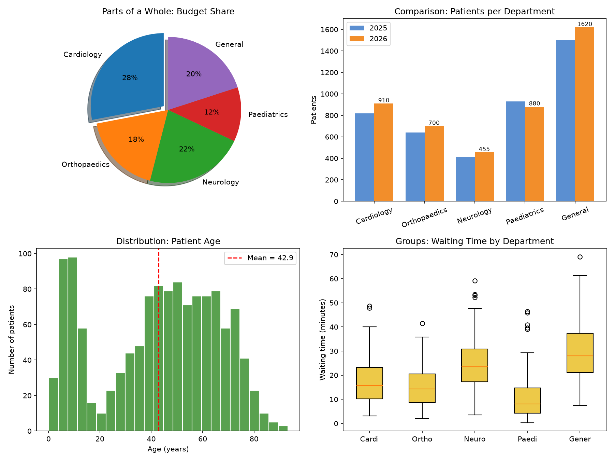
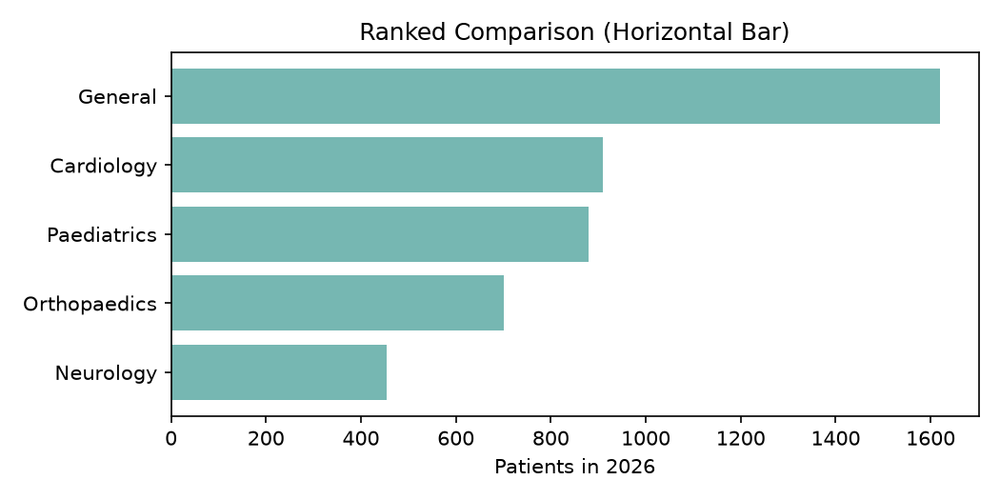

# DATA SCIENCE USING PYTHON
**Date:** 25-11-26
## EXPERIMENT 18 - Choosing the Right Graph: Pie, Bar, Histogram and Box Plots

**DATE: 25/11/26**

### AIM:

To build a hospital operations dashboard by choosing a suitable chart for each type of question.

### QUESTION:

Hospital management wants a one-page visual dashboard that shows the budget share of each department, a comparison of patient counts across two years, the distribution of patient ages and the spread of waiting times in each department. Choose the right type of graph for each question and build the dashboard.

The program must:

1. Show parts of a whole using a pie chart with an exploded slice.
2. Compare categories using grouped and horizontal bar charts with labels.
3. Show the distribution of patient ages using a histogram with the mean marked.
4. Compare groups using box plots of waiting time.
5. Justify the choice of each chart type.

### ALGORITHM:

1. Import NumPy, Pandas and Matplotlib libraries.
2. Create a list of five hospital departments and their budget shares.
3. Define patient counts for 2025 and 2026 for each department.
4. Generate waiting time data using the Gamma distribution.
5. Generate patient age data using normal distributions.
6. Calculate and display budget shares and patient count changes.
7. Calculate patient age statistics including mean, median and standard deviation.
8. Generate waiting time summary statistics for each department.
9. Create a pie chart to represent department budget distribution.
10. Create a grouped bar chart to compare patient counts between 2025 and 2026.
11. Draw a histogram to analyse patient age distribution and mark the mean.
12. Create box plots to compare waiting times across departments.
13. Draw a horizontal bar chart to rank departments based on 2026 patient counts.
14. Save the graphical outputs and display the charts.

### CODE:

```python
import numpy as np
import pandas as pd
import matplotlib.pyplot as plt

np.random.seed(11)

departments = [
    "Cardiology",
    "Orthopaedics",
    "Neurology",
    "Paediatrics",
    "General",
]

budget_share = [28, 18, 22, 12, 20]

patients_2025 = [820, 640, 410, 930, 1500]
patients_2026 = [910, 700, 455, 880, 1620]

wait = {
    d: np.random.gamma(shape=k, scale=6, size=120)
    for d, k in zip(departments, [3, 2.5, 4, 1.8, 5])
}

ages = np.concatenate(
    [
        np.random.normal(8, 4, 300),
        np.random.normal(45, 12, 700),
        np.random.normal(70, 8, 300),
    ]
)

ages = ages[(ages > 0) & (ages < 100)]

print("Hospital Operations Dashboard: Choosing the Right Graph")
print("=" * 56)

print("\nBudget share (%)       :", dict(zip(departments, budget_share)))

print("Patients 2025 vs 2026 :")

for d, a, b in zip(departments, patients_2025, patients_2026):
    print(
        f" {d:<13} {a:>5} {b:>5} "
        f"change = {100 * (b - a) / a:+.1f}%"
    )

print(
    "\nPatient age: n = {}, mean = {:.1f}, median = {:.1f}, std = {:.1f}".format(
        len(ages), ages.mean(), np.median(ages), ages.std()
    )
)

print("\nWaiting time (minutes) summary by department:")

summary = (
    pd.DataFrame(wait)
    .describe()
    .T[["mean", "25%", "50%", "75%", "max"]]
    .round(1)
)

print(summary.to_string())

# ---------- Figure 1: Hospital Operations Dashboard ----------

fig, ax = plt.subplots(2, 2, figsize=(12, 9))

# Pie chart: Department budget share
explode = [
    0.08 if s == max(budget_share) else 0
    for s in budget_share
]

ax[0, 0].pie(
    budget_share,
    labels=departments,
    autopct="%1.0f%%",
    startangle=90,
    explode=explode,
    shadow=True,
)

ax[0, 0].set_title("Parts of a Whole: Budget Share")

# Grouped bar chart: Patient comparison
x = np.arange(len(departments))
w = 0.38

b1 = ax[0, 1].bar(
    x - w / 2,
    patients_2025,
    w,
    label="2025",
    color="#5b8fd1",
)

b2 = ax[0, 1].bar(
    x + w / 2,
    patients_2026,
    w,
    label="2026",
    color="#f28e2b",
)

ax[0, 1].bar_label(b2, fontsize=8)
ax[0, 1].set_xticks(x, departments, rotation=20)
ax[0, 1].set_ylabel("Patients")
ax[0, 1].legend()
ax[0, 1].set_title("Comparison: Patients per Department")

# Histogram: Patient age distribution
ax[1, 0].hist(
    ages,
    bins=25,
    color="#59a14f",
    edgecolor="white",
)

ax[1, 0].axvline(
    ages.mean(),
    color="red",
    linestyle="--",
    label=f"Mean = {ages.mean():.1f}",
)

ax[1, 0].set_xlabel("Age (years)")
ax[1, 0].set_ylabel("Number of patients")
ax[1, 0].set_title("Distribution: Patient Age")
ax[1, 0].legend()

# Box plot: Department waiting times
ax[1, 1].boxplot(
    [wait[d] for d in departments],
    tick_labels=[d[:5] for d in departments],
    patch_artist=True,
    boxprops=dict(facecolor="#edc948"),
)

ax[1, 1].set_ylabel("Waiting time (minutes)")
ax[1, 1].set_title("Groups: Waiting Time by Department")

plt.tight_layout()
plt.savefig("exp18_dashboard.png", dpi=150)
plt.show()

# ---------- Figure 2: Horizontal Bar Chart ----------

fig, ax = plt.subplots(figsize=(7, 3.5))

order = np.argsort(patients_2026)

ax.barh(
    np.array(departments)[order],
    np.array(patients_2026)[order],
    color="#76b7b2",
)

ax.set_xlabel("Patients in 2026")
ax.set_title("Ranked Comparison (Horizontal Bar)")

plt.tight_layout()
plt.savefig("exp18_barh.png", dpi=150)
plt.show()

print("\nSaved figures: exp18_dashboard.png, exp18_barh.png")
```

### OUTPUT:

```text
Hospital Operations Dashboard: Choosing the Right Graph
========================================================

Budget share (%)       : {'Cardiology': 28, 'Orthopaedics': 18, 'Neurology': 22, 'Paediatrics': 12, 'General': 20}

Patients 2025 vs 2026 :
 Cardiology      820   910 change = +11.0%
 Orthopaedics    640   700 change = +9.4%
 Neurology       410   455 change = +11.0%
 Paediatrics     930   880 change = -5.4%
 General        1500  1620 change = +8.0%

Patient age: n = 1289, mean = 42.9, median = 46.3, std = 23.2

Waiting time (minutes) summary by department:
               mean   25%   50%   75%   max
Cardiology    17.6 10.2 15.7 23.2 48.7
Orthopaedics  15.5  8.7 14.3 20.6 41.5
Neurology     25.1 17.2 23.5 30.9 59.2
Paediatrics   11.1  4.3  8.1 14.7 46.5
General       29.8 21.1 28.1 37.4 69.1

Saved figures: exp18_dashboard.png, exp18_barh.png
```

### GRAPHICAL OUTPUT:

**Figure 1: Hospital Operations Dashboard**



**Figure 2: Ranked Comparison Using Horizontal Bar Chart**



1. Budget Share by Department - Pie Chart.
2. Patient Count Comparison for 2025 and 2026 - Grouped Bar Chart.
3. Patient Age Distribution - Histogram.
4. Department-wise Waiting Time - Box Plot.
5. Ranked Patient Comparison - Horizontal Bar Chart.

### RESULT:

Thus, the hospital operations dashboard was successfully developed using Python and Matplotlib. Different graphical representations, including pie charts, grouped bar charts, histograms, box plots and horizontal bar charts, were implemented to analyse hospital budget distribution, patient counts, age distribution and departmental waiting times successfully.