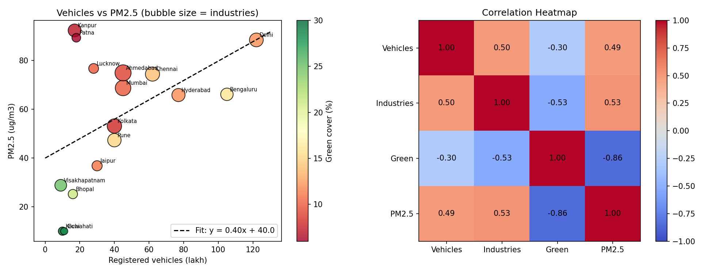
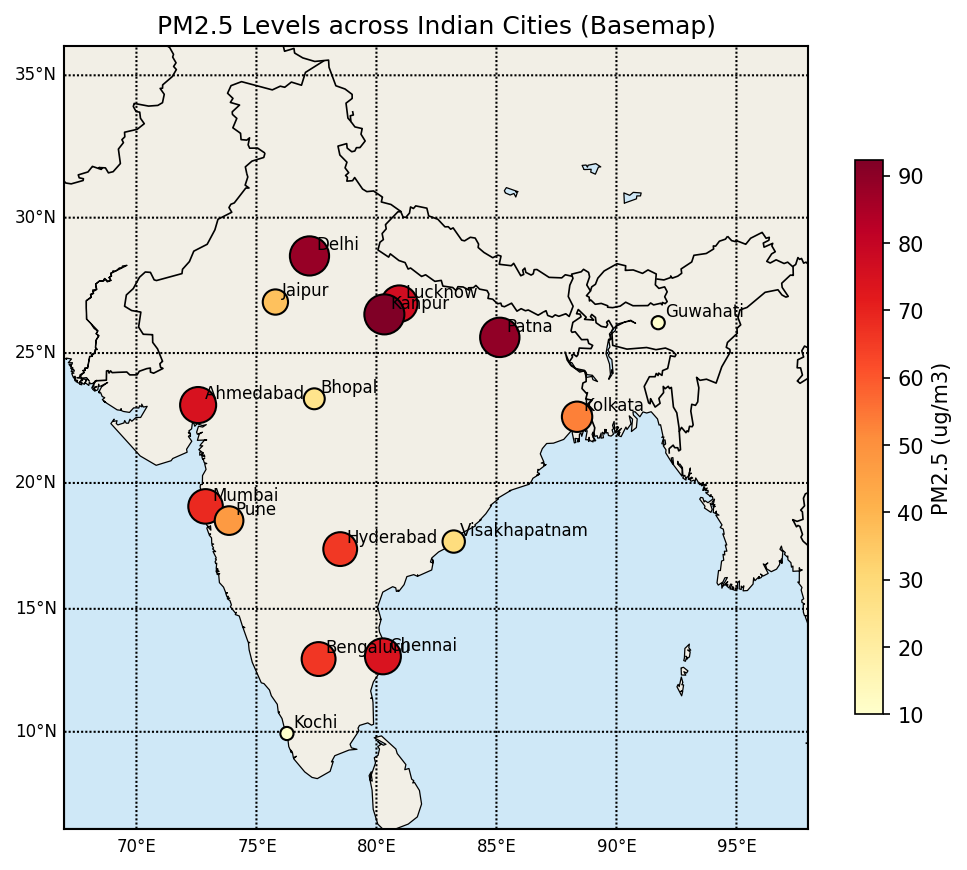

# DATA SCIENCE USING PYTHON

## EXPERIMENT 19 - Scatterplots, Correlations and Geographic Data using Basemap

**DATE: 25/11/26**

### AIM:

To analyse air pollution across Indian cities using advanced scatterplots, a correlation heatmap and a Basemap map.

### QUESTION:

An environmental agency has PM2.5 readings together with vehicle counts, number of industries and green cover for 16 Indian cities. Find out which factors are related to pollution and show the pollution level of each city on a map of India using the Basemap toolkit.

The program must:

1. Compute the Pearson correlation matrix and describe the strength of each relationship.
2. Draw a scatter plot whose colour and size encode extra variables, with labels and a fitted line.
3. Draw a correlation heatmap with the values written in each cell.
4. Plot the cities on a map of India with Basemap (coastlines, borders, parallels and meridians).
5. Handle Basemap deprecation warnings and the case where Basemap is not installed.

### ALGORITHM:

1. Import warnings, NumPy, Pandas and Matplotlib libraries.
2. Import the Basemap toolkit and handle the ImportError condition if it is unavailable.
3. Create a dataset containing 16 Indian cities with latitude, longitude, vehicle count, industries and green cover.
4. Generate PM2.5 values using vehicle count, industrial activity, green cover and random variations.
5. Identify the Indo-Gangetic belt cities and adjust their pollution values.
6. Display the city-wise air pollution dataset.
7. Calculate the Pearson correlation matrix for vehicles, industries, green cover and PM2.5.
8. Analyse the strength and direction of correlations.
9. Identify the three most polluted and least polluted cities.
10. Draw a scatterplot with bubble size representing industries and colour representing green cover.
11. Fit and draw a regression line and add city labels.
12. Create a correlation heatmap with values displayed in each cell.
13. Use Basemap to display Indian cities with geographical boundaries and pollution levels.
14. Save the generated figures and display the charts.

### CODE:

```python
import warnings
import numpy as np
import pandas as pd
import matplotlib.pyplot as plt

# Basemap is a deprecated library: hide its deprecation warnings
warnings.filterwarnings("ignore", category=DeprecationWarning)

try:
    from mpl_toolkits.basemap import Basemap
except ImportError:
    Basemap = None
    print("Basemap not found. Install with: pip install basemap (or use Cartopy)")

# City, latitude, longitude, vehicles (lakh), industries, green cover (%)
records = [
    ("Delhi", 28.61, 77.21, 122, 55, 12),
    ("Mumbai", 19.08, 72.88, 45, 70, 10),
    ("Kolkata", 22.57, 88.36, 40, 60, 8),
    ("Chennai", 13.08, 80.27, 62, 58, 14),
    ("Bengaluru", 12.97, 77.59, 105, 45, 16),
    ("Hyderabad", 17.39, 78.49, 77, 50, 12),
    ("Ahmedabad", 23.02, 72.57, 45, 75, 9),
    ("Pune", 18.52, 73.86, 40, 52, 15),
    ("Jaipur", 26.91, 75.79, 30, 30, 11),
    ("Lucknow", 26.85, 80.95, 28, 28, 10),
    ("Kanpur", 26.45, 80.33, 17, 48, 7),
    ("Patna", 25.59, 85.14, 18, 22, 6),
    ("Bhopal", 23.26, 77.41, 16, 25, 21),
    ("Kochi", 9.93, 76.27, 10, 20, 30),
    ("Visakhapatnam", 17.69, 83.22, 9, 40, 25),
    ("Guwahati", 26.14, 91.74, 11, 15, 28),
]

cols = [
    "city",
    "lat",
    "lon",
    "vehicles_lakh",
    "industries",
    "green_cover"
]

cities = pd.DataFrame(records, columns=cols)

np.random.seed(2)

cities["pm25"] = (
    25
    + 0.4 * cities["vehicles_lakh"]
    + 0.5 * cities["industries"]
    - 0.9 * cities["green_cover"]
    + np.random.normal(0, 5, len(cities))
).clip(lower=10).round(1)

belt = cities["city"].isin(["Kanpur", "Patna", "Lucknow"])
cities.loc[belt, "pm25"] += 40

print("Air Quality Analysis: Scatterplots, Correlation and Geographic Data")
print("=" * 68)

print(
    cities[
        ["city", "vehicles_lakh", "industries", "green_cover", "pm25"]
    ].to_string(index=False)
)

# ---------- Pearson Correlation Analysis ----------

corr = cities[
    ["vehicles_lakh", "industries", "green_cover", "pm25"]
].corr()

print("\nCorrelation matrix (Pearson):")
print(corr.round(3).to_string())

for col in ["vehicles_lakh", "industries", "green_cover"]:
    r = corr.loc[col, "pm25"]

    strength = (
        "strong" if abs(r) > 0.6
        else "moderate" if abs(r) > 0.3
        else "weak"
    )

    print(
        f" pm25 vs {col:<13}: r = {r:+.3f} "
        f"({strength} {'positive' if r > 0 else 'negative'})"
    )

print("\nMost polluted:", cities.nlargest(3, "pm25")["city"].tolist())
print("Least polluted:", cities.nsmallest(3, "pm25")["city"].tolist())

# ---------- Advanced Scatter Plot ----------

fig, ax = plt.subplots(1, 2, figsize=(13, 5))

sc = ax[0].scatter(
    cities["vehicles_lakh"],
    cities["pm25"],
    s=cities["industries"] * 6,
    c=cities["green_cover"],
    cmap="RdYlGn",
    edgecolors="black",
    alpha=0.8,
)

m, b = np.polyfit(
    cities["vehicles_lakh"],
    cities["pm25"],
    1
)

xs = np.linspace(0, 130, 50)

ax[0].plot(
    xs,
    m * xs + b,
    "k--",
    label=f"Fit: y = {m:.2f}x + {b:.1f}"
)

for _, r in cities.iterrows():
    ax[0].annotate(
        r["city"],
        (r["vehicles_lakh"], r["pm25"]),
        fontsize=7,
        xytext=(4, 4),
        textcoords="offset points",
    )

fig.colorbar(sc, ax=ax[0], label="Green cover (%)")

ax[0].set_xlabel("Registered vehicles (lakh)")
ax[0].set_ylabel("PM2.5 (ug/m3)")
ax[0].set_title("Vehicles vs PM2.5 (bubble size = industries)")
ax[0].legend()

# ---------- Correlation Heatmap ----------

im = ax[1].imshow(
    corr,
    cmap="coolwarm",
    vmin=-1,
    vmax=1
)

labels = ["Vehicles", "Industries", "Green", "PM2.5"]

ax[1].set_xticks(range(4), labels)
ax[1].set_yticks(range(4), labels)

for i in range(4):
    for j in range(4):
        ax[1].text(
            j,
            i,
            f"{corr.iloc[i, j]:.2f}",
            ha="center",
            va="center"
        )

fig.colorbar(im, ax=ax[1])
ax[1].set_title("Correlation Heatmap")

plt.tight_layout()
plt.savefig("exp19_scatter.png", dpi=150)

# ---------- Geographic Plot with Basemap ----------

if Basemap is not None:

    plt.figure(figsize=(8, 8))

    mp = Basemap(
        projection="merc",
        llcrnrlat=6,
        urcrnrlat=36,
        llcrnrlon=67,
        urcrnrlon=98,
        resolution="l",
    )

    mp.drawcoastlines(linewidth=0.6)
    mp.drawcountries(linewidth=0.8)

    mp.fillcontinents(
        color="#f2efe6",
        lake_color="#cfe8f7"
    )

    mp.drawmapboundary(fill_color="#cfe8f7")

    mp.drawparallels(
        range(5, 40, 5),
        labels=[1, 0, 0, 0],
        fontsize=8
    )

    mp.drawmeridians(
        range(65, 100, 5),
        labels=[0, 0, 0, 1],
        fontsize=8
    )

    x, y = mp(
        cities["lon"].values,
        cities["lat"].values
    )

    pts = mp.scatter(
        x,
        y,
        s=cities["pm25"] * 4,
        c=cities["pm25"],
        cmap="YlOrRd",
        edgecolors="black",
        zorder=5,
    )

    for xi, yi, name in zip(x, y, cities["city"]):
        plt.text(
            xi + 30000,
            yi + 30000,
            name,
            fontsize=8,
            zorder=6
        )

    plt.colorbar(
        pts,
        shrink=0.6,
        label="PM2.5 (ug/m3)"
    )

    plt.title("PM2.5 Levels across Indian Cities (Basemap)")

    plt.savefig(
        "exp19_map.png",
        dpi=150,
        bbox_inches="tight"
    )

    print("\nSaved figures: exp19_scatter.png, exp19_map.png")

else:
    print("\nGeographical map skipped because Basemap is not installed.")

plt.show()
```

### OUTPUT:

```text
Air Quality Analysis: Scatterplots, Correlation and Geographic Data
====================================================================

          city  vehicles_lakh  industries  green_cover  pm25
         Delhi            122          55           12  88.4
        Mumbai             45          70           10  68.7
       Kolkata             40          60            8  53.1
       Chennai             62          58           14  74.4
     Bengaluru            105          45           16  66.1
     Hyderabad             77          50           12  65.8
     Ahmedabad             45          75            9  74.9
          Pune             40          52           15  47.3
        Jaipur             30          30           11  36.8
       Lucknow             28          28           10  76.7
        Kanpur             17          48            7  92.3
         Patna             18          22            6  89.3
        Bhopal             16          25           21  25.2
         Kochi             10          20           30  10.0
Visakhapatnam              9          40           25  28.8
      Guwahati             11          15           28  10.0

Correlation matrix (Pearson):
               vehicles_lakh  industries  green_cover   pm25
vehicles_lakh          1.000       0.500       -0.302  0.492
industries             0.500       1.000       -0.526  0.525
green_cover           -0.302      -0.526        1.000 -0.857
pm25                   0.492       0.525       -0.857  1.000

 pm25 vs vehicles_lakh: r = +0.492 (moderate positive)
 pm25 vs industries   : r = +0.525 (moderate positive)
 pm25 vs green_cover : r = -0.857 (strong negative)

Most polluted: ['Kanpur', 'Patna', 'Delhi']
Least polluted: ['Kochi', 'Guwahati', 'Bhopal']

Saved figures: exp19_scatter.png, exp19_map.png
```

### GRAPHICAL OUTPUT:

**Figure 1: Scatterplot and Correlation Heatmap**



**Figure 2: PM2.5 Levels across Indian Cities using Basemap**



1. Vehicles vs PM2.5 - Bubble Scatterplot.
2. Pearson Correlation Heatmap.
3. PM2.5 Pollution Levels across 16 Indian Cities.

### RESULT:

Thus, air pollution analysis was successfully performed across 16 Indian cities using Python. Pearson correlation, advanced scatterplots, a correlation heatmap and geographical mapping using Basemap were implemented successfully.

The results indicate moderate positive relationships between PM2.5 and vehicle count (0.492) and industrial activity (0.525), while green cover shows a strong negative relationship with PM2.5 (-0.857). Kanpur, Patna and Delhi were identified as the three most polluted cities in the generated dataset.