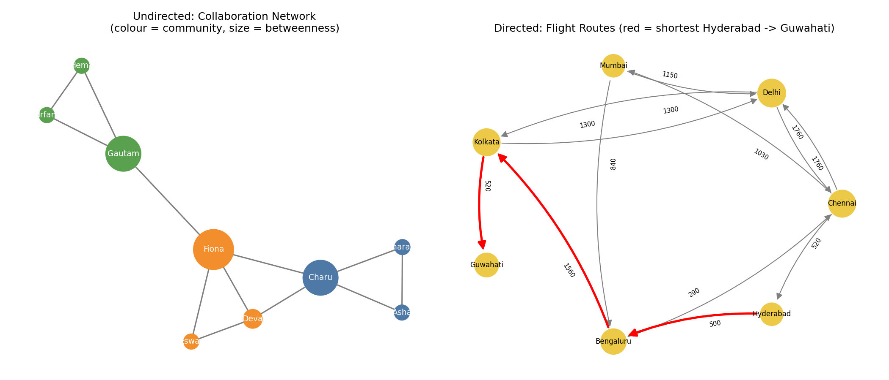

# DATA SCIENCE USING PYTHON

## EXPERIMENT 20 - Visualizing Undirected and Directed Graphs

**DATE: 25/11/26**

### AIM:

To visualise and analyse a research collaboration network and a flight route network.

### QUESTION:

A university wants to understand how its researchers collaborate (an undirected network), and an airline wants to study its route network (a directed, weighted network). Build both graphs with NetworkX, compute important network measures and visualise them with Matplotlib.

The program must:

1. Build an undirected graph and report its nodes, edges, density and connectivity.
2. Compute degree and betweenness centrality, a shortest path and communities.
3. Build a directed weighted graph and report in-degree, out-degree and PageRank.
4. Find the shortest route by distance using Dijkstra's algorithm.
5. Draw both graphs, using colour and node size to show communities, centrality and the shortest route.

### ALGORITHM:

1. Import NetworkX and Matplotlib libraries.
2. Create an undirected graph to represent the research collaboration network.
3. Add researchers as nodes and their collaborations as edges.
4. Calculate the number of nodes, edges, graph density and connectivity.
5. Compute degree and betweenness centrality for each researcher.
6. Find the shortest path between Asha and Irfan.
7. Detect communities using the greedy modularity algorithm.
8. Create a directed weighted graph to represent airline flight routes.
9. Add airports as nodes and flight distances as weighted directed edges.
10. Calculate in-degree, out-degree and PageRank for each airport.
11. Find the shortest route from Hyderabad to Guwahati using Dijkstra's algorithm.
12. Check whether the directed graph is strongly connected.
13. Visualise both networks using Matplotlib, highlighting communities and the shortest route.
14. Save the generated graph image and display the visualisations.

### CODE:

```python
import networkx as nx
import matplotlib.pyplot as plt

print("Network Visualization: Undirected and Directed Graphs")
print("=" * 54)

# ---------- Part A: Undirected graph - research collaboration network ----------

G = nx.Graph()

collaborations = [
    ("Asha", "Bharath"),
    ("Asha", "Charu"),
    ("Bharath", "Charu"),
    ("Charu", "Deva"),
    ("Deva", "Eswar"),
    ("Deva", "Fiona"),
    ("Eswar", "Fiona"),
    ("Fiona", "Gautam"),
    ("Gautam", "Hema"),
    ("Hema", "Irfan"),
    ("Gautam", "Irfan"),
    ("Charu", "Fiona"),
]

G.add_edges_from(collaborations)

print("\nPart A - Undirected collaboration network")
print("Nodes:", G.number_of_nodes(), "| Edges:", G.number_of_edges())
print("Density:", round(nx.density(G), 3), "| Connected:", nx.is_connected(G))

deg = dict(G.degree())
btw = nx.betweenness_centrality(G)

print(f"{'Researcher':<10}{'Degree':>7}{'Betweenness':>13}")

for n in sorted(G, key=lambda n: -btw[n]):
    print(f"{n:<10}{deg[n]:>7}{btw[n]:>13.3f}")

print(
    "Shortest path Asha -> Irfan:",
    " - ".join(nx.shortest_path(G, "Asha", "Irfan"))
)

communities = nx.algorithms.community.greedy_modularity_communities(G)

print("Communities:", [sorted(c) for c in communities])

# ---------- Part B: Directed weighted graph - flight routes ----------

D = nx.DiGraph()

routes = [
    ("Chennai", "Delhi", 1760),
    ("Delhi", "Chennai", 1760),
    ("Chennai", "Mumbai", 1030),
    ("Mumbai", "Delhi", 1150),
    ("Delhi", "Kolkata", 1300),
    ("Kolkata", "Guwahati", 520),
    ("Mumbai", "Bengaluru", 840),
    ("Bengaluru", "Chennai", 290),
    ("Bengaluru", "Kolkata", 1560),
    ("Hyderabad", "Bengaluru", 500),
    ("Chennai", "Hyderabad", 520),
    ("Kolkata", "Delhi", 1300),
]

D.add_weighted_edges_from(routes, weight="km")

print("\nPart B - Directed flight network")
print("Airports:", D.number_of_nodes(), "| Routes:", D.number_of_edges())

print(f"{'Airport':<10}{'In':>4}{'Out':>5}{'PageRank':>10}")

pr = nx.pagerank(D)

for n in sorted(D, key=lambda n: -pr[n]):
    print(f"{n:<10}{D.in_degree(n):>4}{D.out_degree(n):>5}{pr[n]:>10.3f}")

path = nx.dijkstra_path(D, "Hyderabad", "Guwahati", weight="km")

dist = nx.dijkstra_path_length(
    D,
    "Hyderabad",
    "Guwahati",
    weight="km"
)

print(
    "Shortest route Hyderabad -> Guwahati:",
    " -> ".join(path),
    f"({dist} km)"
)

print("Can Guwahati reach any city?", D.out_degree("Guwahati") > 0)
print("Strongly connected:", nx.is_strongly_connected(D))

# ---------- Drawing ----------

fig, ax = plt.subplots(1, 2, figsize=(14, 6))

# Undirected collaboration network
pos = nx.spring_layout(G, seed=4)

colors = ["#4e79a7", "#f28e2b", "#59a14f", "#e15759"]

node_color = [
    colors[i]
    for n in G
    for i, c in enumerate(communities)
    if n in c
]

nx.draw_networkx(
    G,
    pos,
    ax=ax[0],
    node_color=node_color,
    node_size=[300 + 3000 * btw[n] for n in G],
    font_size=9,
    font_color="white",
    edge_color="gray",
    width=1.5,
)

ax[0].set_title(
    "Undirected: Collaboration Network\n"
    "(colour = community, size = betweenness)"
)

ax[0].axis("off")

# Directed flight route network
pos2 = nx.circular_layout(D)

nx.draw_networkx_nodes(
    D,
    pos2,
    ax=ax[1],
    node_color="#edc948",
    node_size=[3000 * pr[n] + 400 for n in D],
)

nx.draw_networkx_labels(
    D,
    pos2,
    ax=ax[1],
    font_size=8,
)

nx.draw_networkx_edges(
    D,
    pos2,
    ax=ax[1],
    arrowstyle="-|>",
    arrowsize=15,
    connectionstyle="arc3,rad=0.12",
    edge_color="gray",
    node_size=1200,
)

# Highlight the shortest route in red
path_edges = list(zip(path, path[1:]))

nx.draw_networkx_edges(
    D,
    pos2,
    ax=ax[1],
    edgelist=path_edges,
    edge_color="red",
    width=2.5,
    arrowstyle="-|>",
    arrowsize=18,
    connectionstyle="arc3,rad=0.12",
    node_size=1200,
)

nx.draw_networkx_edge_labels(
    D,
    pos2,
    ax=ax[1],
    font_size=7,
    label_pos=0.35,
    edge_labels=nx.get_edge_attributes(D, "km"),
)

ax[1].set_title(
    "Directed: Flight Routes "
    "(red = shortest Hyderabad -> Guwahati)"
)

ax[1].axis("off")

plt.tight_layout()

plt.savefig("exp20_graphs.png", dpi=150)
plt.show()

print("\nSaved figure: exp20_graphs.png")
```

### OUTPUT:

```text
Network Visualization: Undirected and Directed Graphs
======================================================

Part A - Undirected collaboration network
Nodes: 9 | Edges: 12
Density: 0.333 | Connected: True

Researcher Degree Betweenness
Fiona           4        0.589
Charu           4        0.429
Gautam          3        0.429
Deva            3        0.054
Asha            2        0.000
Bharath         2        0.000
Eswar           2        0.000
Hema            2        0.000
Irfan           2        0.000

Shortest path Asha -> Irfan:
Asha - Charu - Fiona - Gautam - Irfan

Communities:
[['Asha', 'Bharath', 'Charu'],
 ['Deva', 'Eswar', 'Fiona'],
 ['Gautam', 'Hema', 'Irfan']]

Part B - Directed flight network
Airports: 7 | Routes: 12

Airport     In Out  PageRank
Delhi        3   2    0.202
Chennai      2   3    0.183
Kolkata      2   2    0.183
Bengaluru    2   2    0.146
Guwahati     1   0    0.113
Mumbai       1   2    0.087
Hyderabad    1   1    0.087

Shortest route Hyderabad -> Guwahati:
Hyderabad -> Bengaluru -> Kolkata -> Guwahati (2580 km)

Can Guwahati reach any city? False
Strongly connected: False

Saved figure: exp20_graphs.png
```

### GRAPHICAL OUTPUT:

**Figure 1: Undirected Research Collaboration and Directed Flight Route Networks**



1. Undirected Research Collaboration Network - Communities represented using different node colours and betweenness centrality represented using node sizes.
2. Directed Flight Route Network - Airports connected through weighted directional edges.
3. Shortest Hyderabad to Guwahati Flight Route - Highlighted using red edges.

### RESULT:

Thus, undirected research collaboration and directed weighted flight route networks were successfully implemented using Python and NetworkX. Network measures including degree, betweenness centrality, graph density, connectivity and PageRank were calculated successfully. The shortest collaboration path and the shortest flight route were identified using graph algorithms.

The shortest flight route from Hyderabad to Guwahati was identified as Hyderabad → Bengaluru → Kolkata → Guwahati, covering a total distance of 2,580 km.